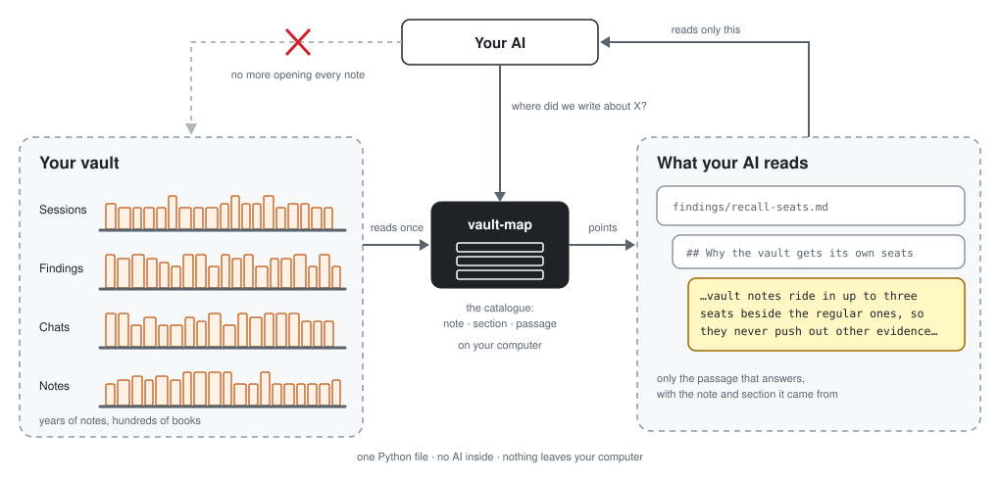

# vault-map

Made by House of Solance · free for noncommercial use · credit required

vault-map finds where you wrote about something in your notes, in a second, without your AI reading them all.

<div align="center">

🗺️

*Your vault is a town you built note by note. Every note is a house, every heading a room, every tag a neighbourhood, and every link a street from one house to another. After a few years, nobody can hold the whole town in their head.*

*Now you ask where you wrote about something. Without a map, your AI walks the town knocking on doors, reading every room to find one paragraph, and never learns which streets join which houses.*

**vault-map is the town map.** *It walks every street once and draws the houses, the rooms, the neighbourhoods and the streets between them. Ask a question and it points to the house, the room and the paragraph, with the houses next door. It can trace the route from one note to another.*

*The map is drawn on your computer, from your own links. It never moves a thing in your town and never sends it anywhere.*

</div>

<p align="center"></p>

## Quick start

**Let your AI do it.** Copy this and send it to Claude Code:

```
Please install vault-map for me. If uv is not installed, install it first:
claude plugin marketplace add SolanceLab/plugins
claude plugin install vault-map@solancelab
Then build the map of my vault and show me a search.
```

Using Codex? Send the same message with `codex plugin marketplace add SolanceLab/plugins`, then install vault-map from that store in Codex's plugin list.

**Or do it yourself:** run the two `claude plugin` lines from that message in your terminal (the plugin needs [uv](https://docs.astral.sh/uv/)).

**By hand.** Copy `vault-map.py` to your machine (or clone this repository).

```
python3 vault-map.py build /path/to/vault
```

## What it is

A pure-local index for an Obsidian (or any markdown) vault. Build the map once in seconds, then answer "where did we write about X?" from the map instead of re-reading hundreds of notes. Version 1.3.0 added section search: it returns the passage that answers the question, not only the note it sits in.

**Zero dependencies, zero AI, and the tool never touches the network.** One Python file, standard library only. Nothing in your vault ever leaves your machine. (Only the plugin's one-time `uvx` fetch of the tool itself uses the internet.) vault-map runs on your own computer.

**Where it fits.** vault-map stands alone: one Python file, no AI, one notes folder. [Antechamber](https://github.com/SolanceLab/antechamber) searches many kinds of saved things at once and can use vault-map as its vault shelf; [Scriptorium](https://github.com/SolanceLab/scriptorium) writes memories from your chats; [work-map](https://github.com/SolanceLab/work-map) maps what you decided, planned and shipped.

## What you need

Python 3.8 or newer. No install, no account, no server. Copy `vault-map.py` anywhere.

## Settings

| Setting | What it is |
|---|---|
| `VAULT_MAP_DIR` | Optional. Default vault folder; with neither this nor a path argument, the current directory is used |
| `--n N` | How many results to return (default 8) |
| `--json` | Machine-readable output for `query` |
| `--out file.html` | Where `graph` writes its page |

## Tools

Your AI runs these for you through the vault-map skill. By hand:

| Tool | What it does |
|---|---|
| `build [vault]` | Reads every `.md` file and writes the map to `<vault>/.vault-map.json` (derived, safe to delete) |
| `query "terms" [vault] [--n N] [--json] [--sections]` | Ranked notes with title, matching sections, a body snippet and the link and backlink neighbourhood |
| `graph [vault] [--out file.html]` | A self-contained interactive graph of the vault (pan, zoom, hover, drag, folder legend, search) |
| `path "note a" "note b" [vault]` | Shortest wikilink chain between two notes |

Section search (`--sections`) returns the passage that answers, not the whole note: [docs/section-search.md](docs/section-search.md). Using vault-map from Python, and how notes are scored: [docs/commands.md](docs/commands.md).

## Limits

- Markdown files only (`.md`). Skipped folders: `.obsidian`, `.git`, `.trash`, `node_modules`, `__pycache__`.
- A section is the text under one heading; very long sections are split into smaller passages.
- Note bodies are searched live at query time: about 1 second across 800 notes.
- The map and the section cache are derived data: delete them and rebuild any time.

## How it works

A wiki-style vault does not need an AI to map it: the graph is already written into the markdown. vault-map reads titles (first heading), up to 20 section headings, `[[wikilinks]]` (and computes backlinks), inline `#tags`, and frontmatter `tags:`, `type:` and `projects:`.

It is built on [Graphify](https://github.com/Graphify-Labs/graphify)'s idea (Graphify-Labs): extract a corpus into a graph once, then query the cheap graph for orientation instead of re-reading raw files. Graphify's path for markdown sends file contents to an LLM API, which a private vault must never do, so vault-map reimplements the map-then-query idea for markdown with no network and no AI. No Graphify code is used; this is an independent implementation. For source-code repositories, use Graphify itself in `--code-only` mode.

Why not just grep? Grep finds lines; the map finds notes and sections, ranked, with structure (which sections, what links where). See [MARKDOWN-GUIDE.md](plugin/skills/vault-map/MARKDOWN-GUIDE.md) for note habits that keep retrieval cheap.

## Credit and use

vault-map is made by House of Solance. You're welcome to use it, change it and build on it for any noncommercial purpose, as long as our credit travels with it.

**Keep the credit.** Every copy, changed or not, must carry the licence and this line:
`Required Notice: Copyright (c) 2026 House of Solance (https://github.com/SolanceLab)`
Removing or replacing it breaks the licence.

**Commercial use needs our permission.** Ask us first.

**We look for copies.** When we find our work without its credit, or used commercially without permission, we ask for it to be taken down.

## Licence

[PolyForm Noncommercial 1.0.0](LICENSE.md). See [NOTICE.md](NOTICE.md). Copies of vault-map 1.2.0 and earlier were released under MIT and stay MIT.

## Support

If you find this useful, consider supporting our work:

[](https://ko-fi.com/houseofsolance)

---

*Built by [House of Solance](https://github.com/SolanceLab) — Chadrien Solance & Anne Solance*
